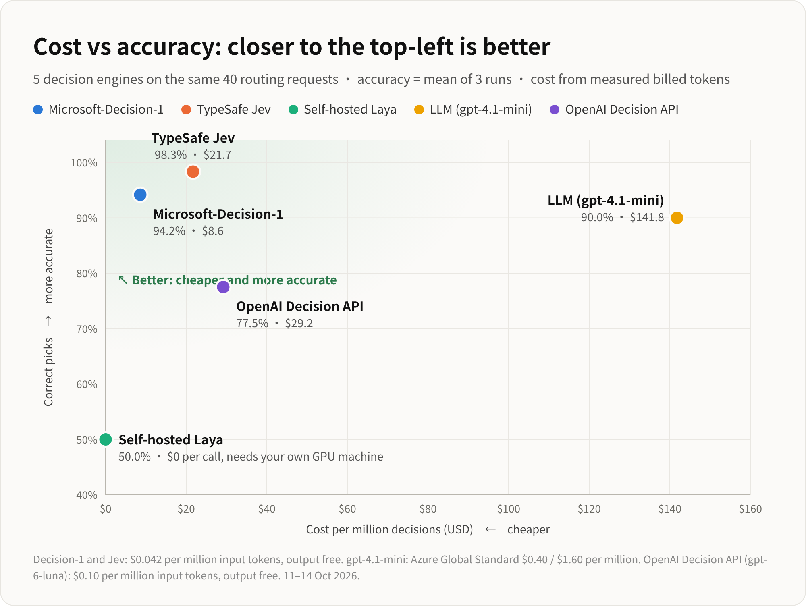

# OpenAI Decision API for Model Routing: Benchmark vs Microsoft-Decision-1, Jev, Laya and an LLM

[English](README.md) | [中文说明](README_zh.md)

A model router gets a user request and must pick the right model to answer it. This benchmark tests **decision engines** on that job, using 40 hand-labelled requests in English and Chinese. It compares how often each engine picks the right model, how fast it decides, and how much each decision costs.

## Data source and what this repo adds

The benchmark dataset comes from Xuefeng Yin's model routing test:

> [[Hands-on test] Microsoft now has a Jev-style decision model too: Microsoft-Decision-1, against Jev, Laya and an LLM on accuracy, speed and price](https://aigbb.notion.site/Hands-on-test-Microsoft-now-has-a-Jev-style-decision-model-too-Microsoft-Decision-1-against-Jev--3f69e34a4f6a8130b3f8d12677a87ff8)
> Xuefeng Yin (AI Apps GBB, Microsoft), 11 Oct 2026

**From the original article:**

- The 40 test requests and their expected models (`data/prompts.json`)
- The results for four engines: Microsoft-Decision-1, TypeSafe Jev, Self-hosted Laya and LLM (`gpt-4.1-mini`). They are in `results/router/`.
- The router benchmark script (`scripts/bench.py`) and the chart style (`scripts/charts.py`, `scripts/scatter.py`)

**Added in this repo:**

- One new engine: the **OpenAI Decision API** (`gpt-6-luna`). It is tested on the same 40 requests, with the same expected models, the same model descriptions and routing instructions, and the same 3-round method.
- The OpenAI test script (`scripts/bench_openai.py`) and its results (`results/openai/`)
- The OpenAI Decision API as a fifth engine in the charts and the report, plus the merge step (`scripts/merge_results.py`)

The four original engines were not re-run here. Their numbers are copied from the original test.

## Results

All five engines see the same five model descriptions and the same routing instructions as the original router benchmark.

- Full report: [docs/model_routing_benchmark.md](docs/model_routing_benchmark.md)



| Decision engine | Correct (/40) | Median decision time | Cost per 1M decisions | Source |
|---|---|---|---|---|
| TypeSafe Jev | 39.3 | 350 ms | $21.7 | Original article |
| Microsoft-Decision-1 | 37.7 | 541 ms | $8.6 | Original article |
| LLM (`gpt-4.1-mini`) | 36 | 1.43 s | $141.8 | Original article |
| **OpenAI Decision API (`gpt-6-luna`)** | **31** | **229 ms** | **$29.2** | **This repo** |
| Self-hosted Laya | 20 | 127 ms | $0 | Original article |

With the same descriptions, the OpenAI Decision API often chose the cheapest model, `gpt-4.1-mini`, for requests that needed `gpt-4o`, `gpt-4.1` or `gpt-6-luna`. It made the same 9 mistakes in all 3 runs.

## Repository layout

```
.
├── data/
│   └── prompts.json              # the 40 test requests and expected models (original article)
├── scripts/
│   ├── bench_openai.py           # run the OpenAI Decision API benchmark (this repo)
│   ├── bench.py                  # run the 4 original engines inside Model Router (original article)
│   ├── merge_results.py          # rebuild summaries and costs, merge them for the charts
│   ├── metrics.py                # shared accuracy, latency and cost calculations
│   ├── charts.py                 # render the accuracy, latency and cost charts
│   ├── scatter.py                # render the cost-vs-accuracy chart
│   └── test_decision_api.py      # minimal OpenAI Decision API example
├── results/
│   ├── router/                   # results for the 4 original engines (original article)
│   ├── openai/                   # OpenAI Decision API results, costs and logs (this repo)
│   ├── summary.json              # all 5 engines merged (chart input)
│   └── cost.json                 # all 5 engines merged (chart input)
├── charts/                       # rendered PNG charts, English (en-*) and Chinese (zh-*)
├── docs/
│   └── model_routing_benchmark.md
└── requirements.txt
```

## Run the benchmark yourself

This repo's own test is the OpenAI Decision API benchmark. Re-run it, then rebuild the charts. The four original engines need the Model Router setup from the original article (see [Re-run the Model Router engines](#optional-re-run-the-model-router-engines)). Their saved results are included, so you don't need to re-run them.

### 1. Install

You need Python 3.13 (other recent versions should also work).

```bash
python3 -m venv .venv
source .venv/bin/activate
pip install -r requirements.txt
playwright install chromium     # only needed to render charts
```

On Linux, install a CJK font so the Chinese charts render correctly, for example `sudo apt install fonts-noto-cjk`.

### 2. Run the OpenAI Decision API benchmark

```bash
export OPENAI_API_KEY=sk-...
python scripts/bench_openai.py 3 original
```

- The first argument is the number of rounds (default `3`).
- The second argument picks which model descriptions the Decision API sees (default `original`):

| Option | Model descriptions | Result in our run |
|---|---|---|
| `original` | The original router model descriptions and routing instructions, word for word. **Use this for fair comparisons.** | 31 / 40 |
| `guided` | Historical experiment following [OpenAI's Decisions guide](https://developers.openai.com/api/docs/guides/decisions); descriptions don't name the test topics. | 39 / 40 |
| `generic` | Historical experiment with very short labels, such as "Fast general-purpose model." | 14.7 / 40 |
| `detailed` | Historical experiment written after seeing the requests; names the test topics and is an upper bound. | 40 / 40 |

- `original` uses `INSTRUCTIONS` and `CRITERIA` in `scripts/bench_openai.py` word for word. The request is sent as `{"user_request": "..."}`, because the instructions refer to `user_request`.
- The three historical options keep their earlier routing instructions, so their saved results can still be reproduced.

The script prints one line per request and writes:

- `results/openai/results_openai_<option>.json`: one record per request and round
- `results/openai/summary_openai_<option>.json`: the summary of that run

A 3-round run makes 121 API calls, including one warm-up call. With `original`, each call uses about 290 input tokens. At $0.10 per 1M input tokens, the whole run costs less than $0.01.

The first call on a new connection can take tens of seconds. The warm-up call absorbs this and is not recorded.

### 3. Rebuild summaries and costs

```bash
python scripts/merge_results.py original
```

This rebuilds every summary and cost file from the raw results. It then merges the four router engines and the chosen OpenAI run into `results/summary.json` and `results/cost.json`.

The argument picks which OpenAI run goes into the charts (default `original`). If that run's raw results are missing, the script stops with an error.

### 4. Render the charts

```bash
python scripts/charts.py en && python scripts/scatter.py en
python scripts/charts.py zh && python scripts/scatter.py zh
```

The PNGs are written to `charts/`:

| File | Chart |
|---|---|
| `en-07-accuracy.png` | Correct picks per engine, Set A and Set B |
| `en-08-latency.png` | Median and 95th-percentile decision time |
| `en-09-cost.png` | Cost per million decisions |
| `en-10-cost-vs-accuracy.png` | Cost vs accuracy scatter plot |

### (Optional) Re-run the Model Router engines

This step reproduces the original article's results. It is not part of this repo's own test.

`scripts/bench.py` sends every request to Model Router's `/v1/config/decision/test` endpoint. It runs Microsoft-Decision-1, TypeSafe Jev, Laya and the LLM engine inside the router. It needs:

- Model Router running locally, with a Foundry connection named `foundry2` that holds `gpt-4.1-mini` and a `msft-decision-1` deployment
- A TypeSafe key in the router's `ai_router.typesafe` setting
- `laya-serve` running on `127.0.0.1:8100`

```bash
MR_BASE=http://127.0.0.1:8000 MR_ADMIN_PASSWORD=... LAYA_API_KEY=... python scripts/bench.py 3
python scripts/merge_results.py
```

This writes `results/router/results.json`.

Router costs come from token usage in `results/router/usage-results.json`. `bench.py` doesn't record token usage, so that file stays as it is unless you capture usage from the router yourself.

## Change the benchmark

### Add or edit test requests

Each entry in `data/prompts.json` is `[language, request, expected model]`:

```json
["EN", "Prove that there are infinitely many primes of the form 4k+3.", "gpt-5.4"]
```

- Set `A` and set `B` are lists of these entries.
- The expected model must be one of the five candidate models.
- Set the expected model before you run any engine, so the labels stay unbiased.

### Change the candidate models or their descriptions

- The model descriptions are in `CRITERIA` in `scripts/bench_openai.py`, and the routing question is in `INSTRUCTIONS`.
- Keep both identical to the router's prompt, so the comparison with the other engines stays fair.
- `GUIDED`, `GENERIC` and `DETAILED` are older experiments. They use `LEGACY_INSTRUCTIONS`.

### Change prices

Prices per 1M tokens are in `PRICES` in `scripts/metrics.py`. Re-run `merge_results.py` and the chart scripts after you change them.

## Notes

- In the original test, the four engines were timed inside Model Router on an Apple M4 Pro in Asia, which called Foundry and Azure OpenAI in East US 2 (11 Oct 2026). In this repo, the OpenAI Decision API was timed on a separate Linux client calling OpenAI directly (14 Oct 2026). Because the setups differ, compare decision times with care.
- All five engines used the same model descriptions and routing instructions.
- The OpenAI Decision API is very sensitive to these descriptions. With descriptions we wrote ourselves, it scored 14.7 to 40 out of 40 (`generic`, `guided`, `detailed`). Only the `original` result (31 / 40) uses the same descriptions as the other engines.
