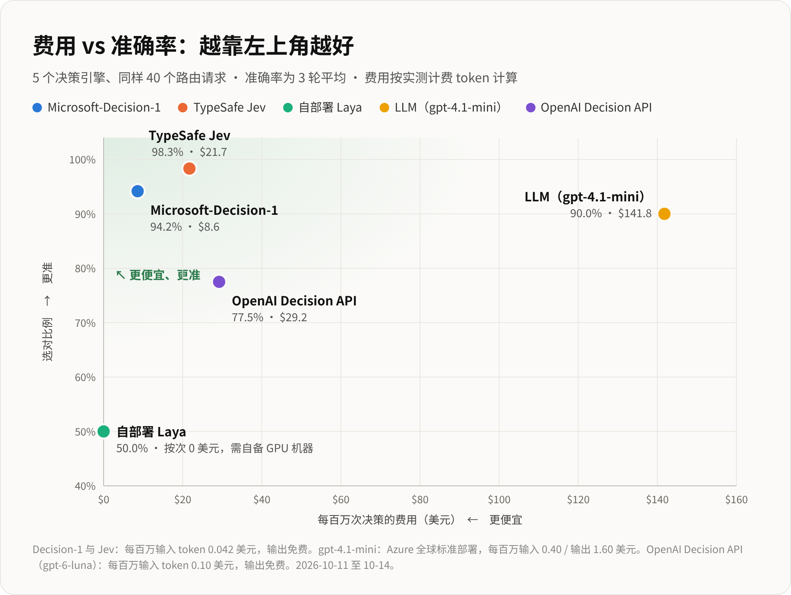

# OpenAI Decision API 模型路由实测：对比 Microsoft-Decision-1、Jev、Laya 与大模型

[English](README.md) | [中文说明](README_zh.md)

在模型路由器（Model Router）接收到用户请求后，需要精准决策并分发给最合适的模型进行响应。本基准测试基于 40 条经过人工标注的中英文真实请求，对比评估各**决策引擎**在模型路由任务中的表现，重点关注**选对率（准确率）**、**决策耗时**与**调用成本**三大核心指标。

## 数据来源与本项目新增内容

测试数据集源自尹学峰（Xuefeng Yin）关于模型路由的实测评测：

> [[实测] 微软也有 Jev 类的决策模型了：Microsoft-Decision-1 与 Jev、Laya、大模型测准确率、速度与价格](https://aigbb.notion.site/Hands-on-test-Microsoft-now-has-a-Jev-style-decision-model-too-Microsoft-Decision-1-against-Jev--3f69e34a4f6a8130b3f8d12677a87ff8)  
> 尹学峰 / Xuefeng Yin (AI Apps GBB, Microsoft), 2026-10-11

**继承自原文的内容：**

- 40 条测试请求及人工标注的期望目标模型（`data/prompts.json`）
- 4 个决策引擎的原测数据：Microsoft-Decision-1、TypeSafe Jev、自部署 Laya 以及普通 LLM（`gpt-4.1-mini`），均保存在 `results/router/`
- 原路由基准测试脚本（`scripts/bench.py`）及图表渲染样式（`scripts/charts.py`、`scripts/scatter.py`）

**本项目新增内容：**

- 补充评测第 5 个引擎：**OpenAI Decision API**（基于 `gpt-6-luna`）。使用相同的 40 条测试请求、期望答案、模型描述与路由指令，以及相同的 3 轮独立测试方法
- OpenAI 评测脚本（`scripts/bench_openai.py`）及实测结果数据（`results/openai/`）
- 将 OpenAI Decision API 作为第 5 个引擎整合进图表与完整报告中，并提供数据合并脚本（`scripts/merge_results.py`）

说明：原文章中的 4 个引擎在本项目中未重复发起调用，直接沿用了原实测数据。

## 评测结果概览

5 个引擎使用相同的 5 条模型描述，以及与原路由器评测相同的路由指令。

- 完整分析报告：[docs/model_routing_benchmark_zh.md](docs/model_routing_benchmark_zh.md)



| 决策引擎 | 选对次数（共 40 题） | 决策耗时中位数 | 百万次决策费用 | 数据来源 |
|---|---|---|---|---|
| TypeSafe Jev | 39.3 | 350 ms | $21.7 | 原文实测 |
| Microsoft-Decision-1 | 37.7 | 541 ms | $8.6 | 原文实测 |
| LLM (`gpt-4.1-mini`) | 36 | 1.43 s | $141.8 | 原文实测 |
| **OpenAI Decision API (`gpt-6-luna`)** | **31** | **229 ms** | **$29.2** | **本项目实测** |
| 自部署 Laya | 20 | 127 ms | $0 | 原文实测 |

在相同描述下，OpenAI Decision API 经常把本应交给 `gpt-4o`、`gpt-4.1` 或 `gpt-6-luna` 的请求分给最便宜的 `gpt-4.1-mini`。3 轮测试中，它每轮都犯了同样的 9 个错误。

## 项目目录结构

```
.
├── data/
│   └── prompts.json              # 40 条测试请求及期望模型（源自原文）
├── scripts/
│   ├── bench_openai.py           # 运行 OpenAI Decision API 评测（本项目）
│   ├── bench.py                  # 在 Model Router 内部评测原文的 4 个引擎（源自原文）
│   ├── merge_results.py          # 重新计算汇总与成本数据，合并输出供制图使用
│   ├── metrics.py                # 通用的准确率、延迟与费用计算逻辑
│   ├── charts.py                 # 渲染准确率、延迟与费用柱状图
│   ├── scatter.py                # 渲染“费用 vs 准确率”散点图
│   └── test_decision_api.py      # OpenAI Decision API 最小化示例
├── results/
│   ├── router/                   # 4 个原引擎的评测数据（源自原文）
│   ├── openai/                   # OpenAI Decision API 实测结果、费用与日志（本项目）
│   ├── summary.json              # 5 个引擎合并后的汇总数据（制图输入）
│   └── cost.json                 # 5 个引擎合并后的成本数据（制图输入）
├── charts/                       # 生成的 PNG 图表，包含英文（en-*）和中文（zh-*）版本
├── docs/
│   ├── model_routing_benchmark.md    # 英文评测报告
│   └── model_routing_benchmark_zh.md # 中文评测报告
└── requirements.txt
```

## 本地运行指南

本项目自带的核心测试针对 OpenAI Decision API。你可以直接重新运行该测试并重新渲染图表。原文章中的 4 个引擎依赖 Model Router 本地服务架构（详见[可选：重跑 Model Router 引擎](#可选重跑-model-router-引擎)）；仓内已包含完整的历史结果数据，通常无需重跑。

### 1. 安装依赖

推荐使用 Python 3.13（其他较新的 Python 3 版本亦可）：

```bash
python3 -m venv .venv
source .venv/bin/activate
pip install -r requirements.txt
playwright install chromium     # 仅用于图表渲染
```

在 Linux 系统下如果需要渲染中文字体，请安装 CJK 字体包，例如：`sudo apt install fonts-noto-cjk`。

### 2. 运行 OpenAI Decision API 评测

```bash
export OPENAI_API_KEY=sk-...
python scripts/bench_openai.py 3 original
```

- 第一个参数指定测试轮数（默认 `3` 轮）。
- 第二个参数指定传递给 Decision API 的模型描述策略（默认 `original`）：

| 策略参数 | 模型描述方式 | 本次实测表现 |
|---|---|---|
| `original` | 逐字采用原路由器的模型描述与路由指令。**用于公平的横向对比，推荐使用此项。** | 31 / 40 |
| `guided` | 历史实验：遵循 [OpenAI Decisions 官方指南规范](https://developers.openai.com/api/docs/guides/decisions)，不提及具体测试话题。 | 39 / 40 |
| `generic` | 历史实验：极简描述，如“通用快速模型”。 | 14.7 / 40 |
| `detailed` | 历史实验：看到测试题后编写，直接包含测试话题，可作为准确率上限参考。 | 40 / 40 |

- `original` 逐字使用 `scripts/bench_openai.py` 中的 `INSTRUCTIONS` 与 `CRITERIA`。由于指令中提到了 `user_request`，请求会以 `{"user_request": "..."}` 的形式发送。
- 三个历史策略保留原先的路由指令，以便复现已保存的结果。

脚本在终端中会逐行打印每条请求的路由结果，并在结束后生成：

- `results/openai/results_openai_<option>.json`：记录每轮每个请求的详细结果
- `results/openai/summary_openai_<option>.json`：该次测试的指标汇总

运行完整的 3 轮测试共发起 121 次 API 调用（含 1 次预热）。使用 `original` 时，每次调用约消耗 290 个 input token，按每百万 input token $0.10 计费，总花费不足 1 美分（< $0.01）。

新连接上的第一次调用可能需要几十秒。预热调用会承担这部分耗时，且不计入结果。

### 3. 重新聚合汇总与成本数据

```bash
python scripts/merge_results.py original
```

从原始结果文件中重新计算每个引擎的指标与费用，将 4 个路由引擎与所选的 OpenAI 测试结果合并，输出至 `results/summary.json` 和 `results/cost.json`。

参数用于指定哪一次 OpenAI 测试进入图表（默认 `original`）。如果缺少该测试的原始结果，脚本会报错退出。

### 4. 渲染可视化图表

```bash
python scripts/charts.py en && python scripts/scatter.py en
python scripts/charts.py zh && python scripts/scatter.py zh
```

生成的 PNG 图片将保存在 `charts/` 目录：

| 文件名 | 图表内容 |
|---|---|
| `zh-07-accuracy.png` | 各引擎在 A 组与 B 组的选对次数对比 |
| `zh-08-latency.png` | 决策耗时中位数与 P95 对比 |
| `zh-09-cost.png` | 每百万次决策费用对比 |
| `zh-10-cost-vs-accuracy.png` | 费用 vs 准确率散点图 |

### （可选）重跑 Model Router 引擎

本步骤用于复现原文章中的测试数据，并非本项目的必要测试流程。

`scripts/bench.py` 会把每个请求发送到 Model Router 的 `/v1/config/decision/test` 接口，在路由器内部统一调度 Microsoft-Decision-1、TypeSafe Jev、Laya 和普通 LLM。运行前需要满足以下环境前提：

- 本地运行 Model Router，并在其中配置名为 `foundry2` 的 Foundry 连接，该连接下挂载 `gpt-4.1-mini` 和 `msft-decision-1` 部署
- 在路由器的 `ai_router.typesafe` 配置项中填入 TypeSafe API Key
- 在 `127.0.0.1:8100` 启动 `laya-serve` 实例

```bash
MR_BASE=http://127.0.0.1:8000 MR_ADMIN_PASSWORD=... LAYA_API_KEY=... python scripts/bench.py 3
python scripts/merge_results.py
```

执行后会覆写 `results/router/results.json`。

路由器各引擎的成本是基于 `results/router/usage-results.json` 中记录的 token 消耗计算的。`bench.py` 本身不采集 token 消耗数据，因此除非你自己从路由器重新提取 usage，否则该文件保持现状即可。

## 自定义与扩展测试

### 增加或修改测试用例

`data/prompts.json` 中的每条数据格式均为 `[语种, 请求内容, 期望模型]`：

```json
["EN", "Prove that there are infinitely many primes of the form 4k+3.", "gpt-5.4"]
```

- `A` 组和 `B` 组均为这种格式的列表。
- 期望模型必须属于设定的 5 个候选模型之一。
- 期望模型务必在运行任何引擎之前人工标定完毕，确保无偏。

### 调整候选模型及其描述文本

- 模型描述位于 `scripts/bench_openai.py` 的 `CRITERIA` 中，路由问题位于 `INSTRUCTIONS` 中。
- 请保持两者与原路由器的 prompt 完全一致，确保与其他引擎的对比公平。
- `GUIDED`、`GENERIC` 和 `DETAILED` 是早期实验，使用 `LEGACY_INSTRUCTIONS`。

### 调整模型单价

每百万 token 的计费单价配置在 `scripts/metrics.py` 的 `PRICES` 字典中。修改后需重新运行 `merge_results.py` 并重新生成图表。

## 说明与注意事项

- **网络环境与测试链路差异**：原文中的 4 个引擎是在位于亚洲的 Apple M4 Pro 上通过 Model Router 内部统计耗时，跨洋调用了部署在美国东部 2（East US 2）的 Foundry 与 Azure OpenAI 服务（测试时间为 2026-10-11）；而本项目的 OpenAI Decision API 则是在另一台独立的 Linux 客户端直接公网调用 OpenAI 官方接口测得（测试时间为 2026-10-14）。两者的网络环境和调用链路不同，横向对比决策耗时时请留意这一差异。
- **模型描述对效果影响很大**：5 个引擎使用相同的模型描述与路由指令。OpenAI Decision API 对描述非常敏感：使用我们自己编写的描述时，成绩在 14.7 到 40 / 40 之间（`generic`、`guided`、`detailed`）。只有 `original` 的结果（31 / 40）与其他引擎使用相同描述。
