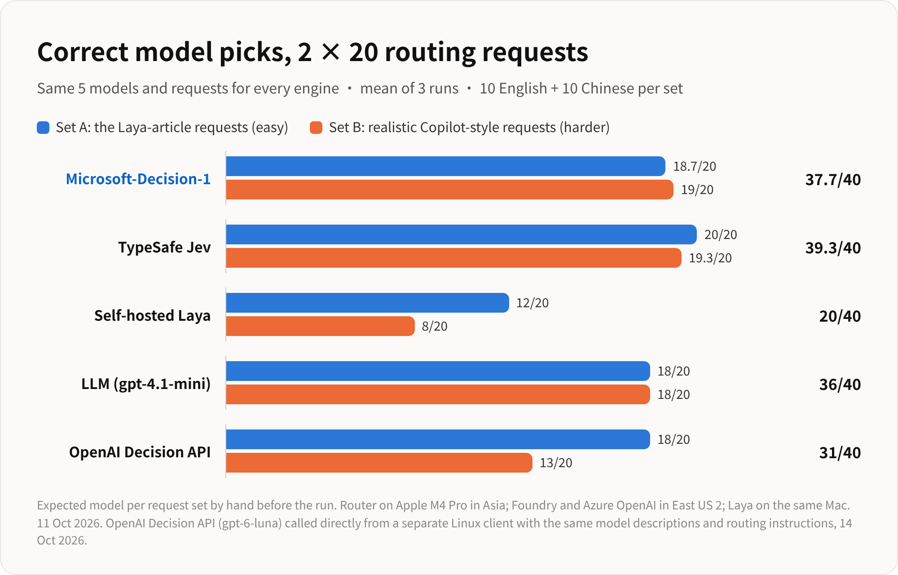
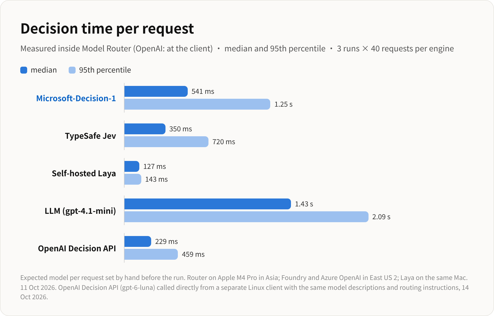
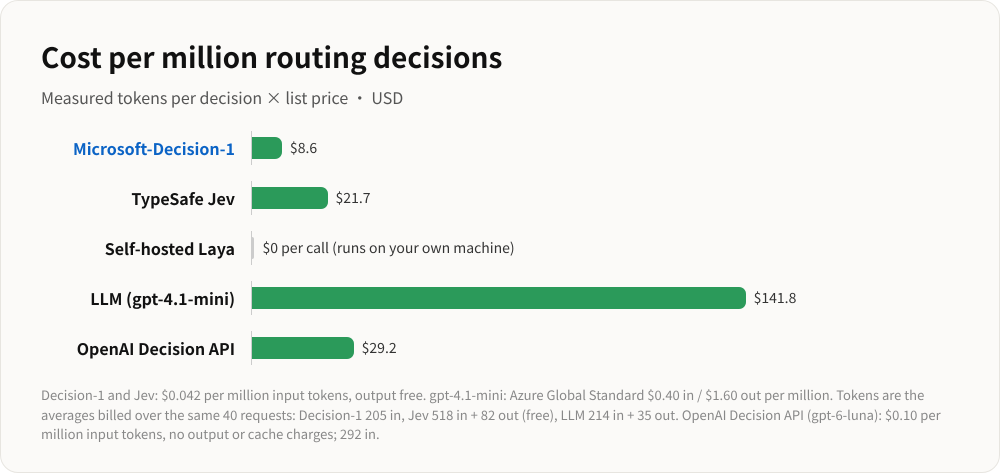

# Model Selection for Request Routing: Decision Engine Benchmark

[English](model_routing_benchmark.md) | [中文说明](model_routing_benchmark_zh.md)

This document compares five decision engines on one job: picking the right model for each user request.

**Short answer:** TypeSafe Jev (98%) and Microsoft-Decision-1 (94%) were the most accurate. Microsoft-Decision-1 was also the cheapest paid engine. The OpenAI Decision API was the fastest cloud engine, but it picked the right model only 78% of the time. It often chose the cheapest model when a stronger one was needed. Self-hosted Laya was fast and free, but it picked the right model only half the time.

All five engines saw the same model descriptions and the same routing instructions.

## 1. Scenario for this benchmark

A model router sits in front of several models. A user request comes in. The router must pick one model to answer it.

The best model depends on the request:

- A greeting does not need a strong model.
- A math proof does need one.
- Sending easy requests to a strong model costs too much.
- Sending hard requests to a weak model gives bad answers.

A **decision engine** reads the request and returns the model to use. This benchmark tests five decision engines:

| Decision engine | What it is |
|---|---|
| Microsoft-Decision-1 | A decision model deployed on Microsoft Foundry (`msft-decision-1`) |
| TypeSafe Jev | A hosted decision service |
| Self-hosted Laya | A small classifier running on the same machine as the router |
| LLM (gpt-4.1-mini) | A general chat model, asked in a prompt to pick a model |
| OpenAI Decision API | OpenAI's `/v1/decisions` endpoint with `gpt-6-luna`, using a `choice` question |

### The test requests

- There are **40 requests**, in two sets of 20.
- **Set A** (easier) reuses the requests from the earlier Laya article.
- **Set B** (harder) uses realistic, Copilot-style requests.
- Each set has 10 English and 10 Chinese requests.
- The correct model for every request was chosen by hand **before** any engine ran.
- Each engine ran all 40 requests **3 times**. The results show the mean of the 3 runs.

## 2. Candidate models

The router can choose from five models. Every engine sees the same description for each model:

| Model | Description given to every engine | Example requests |
|---|---|---|
| `gpt-4.1-mini` | Cheapest and fastest. Greetings, chit-chat, trivial one-line questions, simple translation. | "hi there, how are you today?" · "How many days are there in a leap year?" |
| `gpt-4o` | Fast general-purpose model. Summaries, rewriting, format conversion, short everyday answers. | "Convert this CSV row to JSON…" · "Make this commit message sound more professional…" |
| `gpt-4.1` | Solid coding model. Everyday programming, writing and explaining code, moderate debugging. | "Why does this Go code deadlock?…" · "这条 SQL 为什么这么慢？…" |
| `gpt-5.4` | Strongest reasoning model. Hard algorithms, mathematical proofs, complex system design, deep multi-step analysis. | "Prove that there are infinitely many primes of the form 4k+3." · "Design a globally distributed, strongly consistent payment ledger…" |
| `gpt-6-luna` | Creative long-form writing: stories, poems, marketing copy, storytelling. | "Write a whimsical bedtime story about a dragon…" · "以一只老猫的视角，写一段关于搬家的独白。" |

Each model is the correct answer for 8 of the 40 requests.

Every engine also gets the same routing instruction:

> Which backend model should handle `user_request`? Pick the option whose description best matches what the request needs. Prefer a cheaper, faster model when the request is simple, and a stronger model only when the request needs it.

## 3. Benchmark results

### 3.1 Accuracy

| Decision engine | Set A (/20) | Set B (/20) | English (/20) | Chinese (/20) | Total (/40) |
|---|---|---|---|---|---|
| TypeSafe Jev | 20 | 19.3 | 19.3 | 20 | **39.3** |
| Microsoft-Decision-1 | 18.7 | 19 | 19.7 | 18 | **37.7** |
| LLM (gpt-4.1-mini) | 18 | 18 | 18 | 18 | **36** |
| OpenAI Decision API | 18 | 13 | 15 | 16 | **31** |
| Self-hosted Laya | 12 | 8 | 12 | 8 | **20** |

What went wrong for each engine:

- **TypeSafe Jev** missed one request in 2 of the 3 runs. It sent "Add type hints to this function…" to `gpt-4.1-mini` instead of `gpt-4.1`.
- **OpenAI Decision API** missed the same 9 requests in every run. Eight of them went to `gpt-4.1-mini`, the cheapest model:
  - five text transforms that needed `gpt-4o`: "Convert this CSV row to JSON…" (English and Chinese), "Turn these notes into a bulleted list…", "把这句话改得礼貌一点…" and "一句话概括：这个 PR…"
  - one coding question that needed `gpt-4.1`: "My React useEffect runs twice in development…"
  - two creative requests that needed `gpt-6-luna`: "Give me a fun, rhyming toast…" and "以一只老猫的视角…"
  - It also sent the probability question "What is the expected number of fair coin flips until HTHT…" to `gpt-4o` instead of `gpt-5.4`.
- **Microsoft-Decision-1** sometimes sent text-transform requests to `gpt-4.1-mini` instead of `gpt-4o`. Two Chinese summaries were missed in every run, and the CSV-to-JSON request was missed once.
- **LLM (gpt-4.1-mini)** sent the four short factual questions to `gpt-4o` instead of `gpt-4.1-mini` in every run. For example: "What's the capital of Australia?"
- **Self-hosted Laya** made mistakes across all five models. It picked `gpt-4o` far more often than any other model. It did worse on Set B and on Chinese requests.

### 3.2 Decision time

| Decision engine | Median | 95th percentile |
|---|---|---|
| Self-hosted Laya | 127 ms | 143 ms |
| OpenAI Decision API | 229 ms | 459 ms |
| TypeSafe Jev | 350 ms | 720 ms |
| Microsoft-Decision-1 | 541 ms | 1.25 s |
| LLM (gpt-4.1-mini) | 1.43 s | 2.09 s |

- Laya is fastest because it runs on the same machine. It makes no network call.
- The OpenAI Decision API was the fastest cloud engine.
- The general LLM was the slowest. It writes a text answer instead of returning a single choice.

### 3.3 Cost

| Decision engine | Tokens per decision | Price per 1M tokens | Cost per 1M decisions | Cost per month at 440K decisions |
|---|---|---|---|---|
| Self-hosted Laya | 213 in | $0 (your own machine) | $0 | $0 |
| Microsoft-Decision-1 | 205 in | $0.042 in, output free | $8.6 | $3.79 |
| TypeSafe Jev | 518 in + 82 out | $0.042 in, output free | $21.7 | $9.57 |
| OpenAI Decision API | 292 in | $0.10 in, no output or cache charges | $29.2 | $12.83 |
| LLM (gpt-4.1-mini) | 214 in + 35 out | $0.40 in, $1.60 out | $141.8 | $62.40 |

- Token counts are the averages billed over the benchmark requests.
- Microsoft-Decision-1 is the cheapest paid engine.
- The general LLM costs about 5 to 16 times more than the decision engines.
- Laya has no cost per call, but you must run and maintain your own machine for it.

### 3.4 Cost vs accuracy

The best engines sit in the top-left corner: high accuracy at low cost.

- **Microsoft-Decision-1** and **TypeSafe Jev** form the top-left group.
  - Microsoft-Decision-1 is the cheapest.
  - TypeSafe Jev is slightly more accurate, but costs 2.5 times more.
- The **OpenAI Decision API** costs about the same as TypeSafe Jev, but it is much less accurate (78% vs 98%).
- **LLM (gpt-4.1-mini)** is accurate, but it is far to the right because it costs much more.
- **Self-hosted Laya** costs nothing per call, but its accuracy is too low for routing.

### 3.5 Stability and confidence

| Decision engine | Same pick in all 3 runs | Mean probability of the picked model | Picks with probability ≥ 0.9 |
|---|---|---|---|
| TypeSafe Jev | 39 / 40 | 0.92 | 73% |
| Microsoft-Decision-1 | 39 / 40 | 0.91 | 75% |
| OpenAI Decision API | 40 / 40 | 0.78 | 38% |
| Self-hosted Laya | 40 / 40 | 0.43 | 8% |
| LLM (gpt-4.1-mini) | 40 / 40 | not available | not available |

- All engines were stable: they gave the same pick in almost every run.
- Microsoft-Decision-1 and TypeSafe Jev were usually confident in their picks.
- The OpenAI Decision API was always stable, but less confident. It was stable even when wrong: it made the same 9 mistakes in every run.
- Laya was stable but not confident. Its probabilities were spread across many models.
- The general LLM does not return probabilities.
- No engine returned an error.

### 3.6 Things to keep in mind

- **Same descriptions for every engine.** The OpenAI Decision API used the router's model descriptions and routing instruction word for word. The request was sent as `{"user_request": "..."}`, because the instruction refers to `user_request`. A check run with the plain request text scored about the same (32 / 40).
- **Model descriptions matter a lot for the OpenAI Decision API.** In earlier runs with descriptions we wrote ourselves, it scored 14.7 / 40 (very short labels), 39 / 40 (descriptions following OpenAI's guide) and 40 / 40 (descriptions naming the test topics). Those runs used different descriptions from the other engines, so they are not a fair comparison.
- **Decision time was measured in two different setups.** For the first four engines, it was measured inside the router on an Apple M4 Pro in Asia, which called Foundry and Azure OpenAI in East US 2. For the OpenAI Decision API, it was measured on a separate Linux client calling OpenAI directly.
- **Run dates:** 11 Oct 2026 for the first four engines, and 14 Oct 2026 for the OpenAI Decision API.
- **Chinese charts:** the [charts](../charts/) folder also has `zh-07-accuracy.png`, `zh-08-latency.png`, `zh-09-cost.png` and `zh-10-cost-vs-accuracy.png`.
