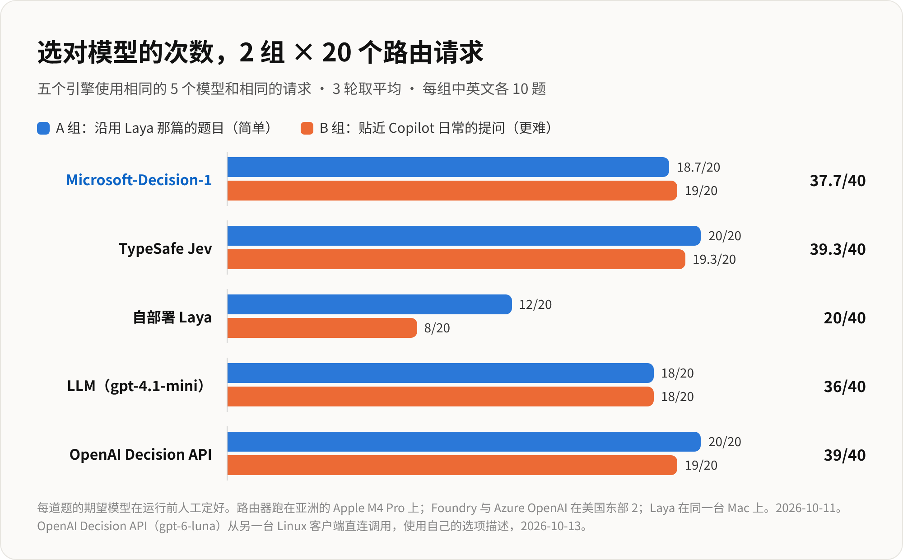
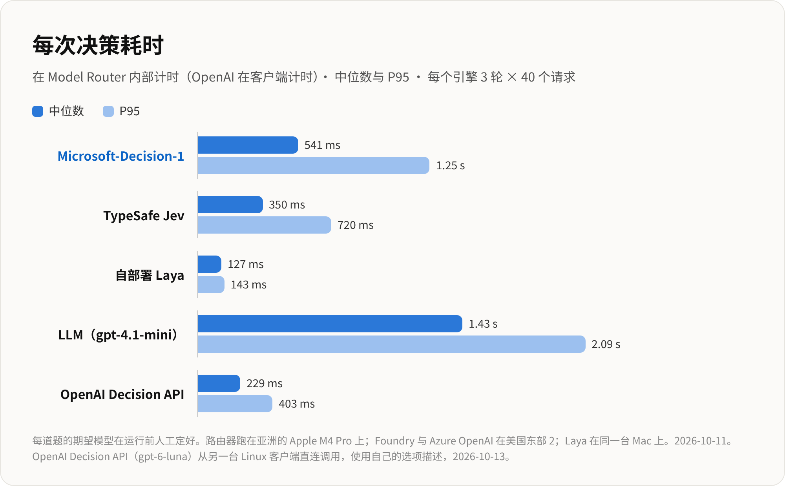
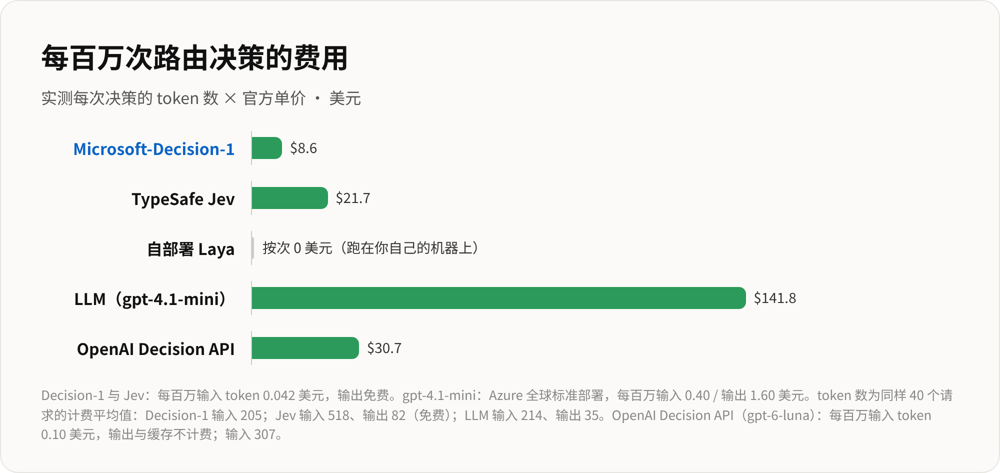

# 请求路由中的模型选择：五大决策引擎横向评测

[English](model_routing_benchmark.md) | [中文说明](model_routing_benchmark_zh.md)

本文在统一的测试集与标准下，对比了五款决策引擎在“为用户请求分发最优模型”这一核心场景中的综合表现。

**核心结论：** TypeSafe Jev、OpenAI Decision API 和 Microsoft-Decision-1 三者准确率均处在第一梯队（94%～98%）。其中 Microsoft-Decision-1 成本最低；OpenAI Decision API 是云端引擎中响应最快的；自部署的 Laya 速度极快且调用免费，但选对模型的比例仅有一半左右（50%）。

## 1. 评测背景与测试场景

在智能路由架构中，模型路由器（Model Router）作为前端网关承接各类用户请求，并负责精准分发给下游最合适的模型。

不同难度的请求对模型能力的需求截然不同：
- 简单的打招呼或闲聊无需动用大模型；
- 复杂的数学证明或架构设计则必须交由推理旗舰模型处理；
- “杀鸡用牛刀”把简单请求分给昂贵大模型，会导致账单爆炸；
- “小马拉大车”把难题分给轻量模型，则会导致回答质量崩塌。

**决策引擎（Decision Engine）**正是负责快速分析请求并挑选最优模型的“大脑”。本次横向评测涵盖了以下五款决策引擎：

| 决策引擎 | 架构形式与运行方式 |
|---|---|
| Microsoft-Decision-1 | 部署于 Microsoft Foundry 上的专用决策模型（`msft-decision-1`） |
| TypeSafe Jev | 托管型云端决策商业服务 |
| 自部署 Laya | 部署在路由器同机运行的轻量级本地分类模型 |
| LLM（gpt-4.1-mini） | 通用聊天大模型，通过 Prompt 引导其选择目标模型 |
| OpenAI Decision API | OpenAI 的 `/v1/decisions` 接口（基于 `gpt-6-luna`），使用 `choice` 单选题模式 |

### 测试集设计

- 共 **40 条测试请求**，分为两个测试集，每集 20 题。
- **A 组（基础题）**：沿用此前 Laya 测试文章中的题目，难度相对直观。
- **B 组（进阶题）**：贴近真实日常开发（类似 Copilot 实际交互）中的提问，难度更高。
- 每组均包含 10 条英文请求和 10 条中文请求。
- 所有请求的标准答案（期望模型）均在**任何引擎测试运行前**由人工标注锁定。
- 每个引擎对全部 40 条请求**独立运行 3 轮**，最终结果取 3 轮表现的平均值。

## 2. 候选模型梯队与分工

路由器下游共有 5 款不同定位的模型可供挑选，每款模型职责清晰：

| 模型 | 角色定位 | 适用场景（何时选用） | 代表性请求示例 |
|---|---|---|---|
| `gpt-4.1-mini` | 最轻量、最省钱 | 随意闲聊、简单事实问答（单一确定答案） | “你好，今天怎么样？” · “澳大利亚的首都是哪里？” |
| `gpt-4o` | 高速通用、文本处理 | 用户提供文本的转化类任务：摘要、改写、润色、格式转换 | “把这行 CSV 转成 JSON…” · “把这句话改得礼貌一点…” |
| `gpt-4.1` | 扎实的代码主力 | 编写、审查、排查或解释代码/SQL | “这段 Go 代码为什么会死锁？…” · “这条 SQL 为什么这么慢？…” |
| `gpt-5.4` | 顶级逻辑推理 | 数学证明、公式推导、复杂系统架构设计与深度权衡分析 | “证明存在无穷多个形如 4k+3 的素数。” · “设计一个全球分布、强一致的支付账本系统…” |
| `gpt-6-luna` | 创意写作与文风把控 | 注重行文质感、语调与创意的原创写作 | “写一个关于害怕黑夜的小龙的睡前童话故事。” · “以一只老猫的视角，写一段关于搬家的独白。” |

40 道题目中，每个模型对应的标准答案各为 8 题，分布均匀。

## 3. 详细测试结果

### 3.1 准确率

| 决策引擎 | A 组 (/20) | B 组 (/20) | 英文 (/20) | 中文 (/20) | 总计 (/40) |
|---|---|---|---|---|---|
| TypeSafe Jev | 20 | 19.3 | 19.3 | 20 | **39.3** |
| OpenAI Decision API | 20 | 19 | 19 | 20 | **39** |
| Microsoft-Decision-1 | 18.7 | 19 | 19.7 | 18 | **37.7** |
| LLM（gpt-4.1-mini） | 18 | 18 | 18 | 18 | **36** |
| 自部署 Laya | 12 | 8 | 12 | 8 | **20** |

各引擎的典型失分情况：

- **TypeSafe Jev**：在 3 轮中有 2 轮错了一题，将给函数添加类型注解的请求（“Add type hints to this function…”）错误路由到了 `gpt-4.1-mini`，未能识别应分配给写代码的 `gpt-4.1`。
- **OpenAI Decision API**：每轮均稳定错了一题，将排查 React useEffect 重复执行的请求（“My React useEffect runs twice in development…”）误判给了 `gpt-4.1-mini`，未分配给写代码的 `gpt-4.1`。
- **Microsoft-Decision-1**：偶尔将文本变换类请求误判给 `gpt-4.1-mini` 而非 `gpt-4o`。其中两条中文摘要题在 3 轮中均判断失误，CSV 转 JSON 的请求失误了 1 次。
- **LLM（gpt-4.1-mini）**：在每轮测试中，均把 4 道简短的事实问答题（例如“澳大利亚的首都是哪里？”）错分给了 `gpt-4o`，未能选对更便宜轻量的 `gpt-4.1-mini`。
- **自部署 Laya**：在 5 个模型上全面出现误判，且严重偏向将请求投向 `gpt-4o`；在难度更高的 B 组以及中文题目上表现尤为吃力。

### 3.2 决策耗时

| 决策引擎 | 耗时中位数 (P50) | P95 耗时 |
|---|---|---|
| 自部署 Laya | 127 ms | 143 ms |
| OpenAI Decision API | 229 ms | 403 ms |
| TypeSafe Jev | 350 ms | 720 ms |
| Microsoft-Decision-1 | 541 ms | 1.25 s |
| LLM（gpt-4.1-mini） | 1.43 s | 2.09 s |

- **自部署 Laya 速度最快**：由于与路由器同机部署，无需任何网络跳转，延迟极低且表现非常平稳。
- **OpenAI Decision API 是云端引擎中最快的**：响应耗时中位数仅 229 ms。
- **通用 LLM 最慢**：因为它需要通过常规文本生成来输出完整文字回答，相比直接输出分类选项的专用决策服务有明显的额外开销。

### 3.3 决策成本

| 决策引擎 | 每次决策消耗 Token | 每百万 Token 官方单价 | 百万次决策费用 | 月调用 44 万次预估费用 |
|---|---|---|---|---|
| 自部署 Laya | 213 input | $0（使用自有机器） | $0 | $0 |
| Microsoft-Decision-1 | 205 input | $0.042 input，output 免费 | $8.6 | $3.79 |
| TypeSafe Jev | 518 input + 82 output | $0.042 input，output 免费 | $21.7 | $9.57 |
| OpenAI Decision API | 307 input | $0.10 input，无 output 或缓存费 | $30.7 | $13.49 |
| LLM（gpt-4.1-mini） | 214 input + 35 output | $0.40 input / $1.60 output | $141.8 | $62.40 |

- Token 消耗统计为评测请求在实际计费时的平均数值。
- **Microsoft-Decision-1 是所有付费引擎中单价最低的**，百万次调用仅需 $8.6。
- **通用 LLM 的决策成本极其高昂**，达到专用决策引擎的 5 到 16 倍。
- **自部署 Laya 没有单次调用 API 费用**，但需要企业自行承担 GPU 服务器的硬件与运维成本。

### 3.4 费用 vs 准确率权衡

在二维分布图中，**越靠左上角越理想**：代表既便宜又准确。

- **Microsoft-Decision-1**、**TypeSafe Jev** 和 **OpenAI Decision API** 聚集在左上黄金区间：
  - Microsoft-Decision-1 成本最低，但准确率稍逊一筹（37.7 题）；
  - TypeSafe Jev 与 OpenAI Decision API 准确率更高（39～39.3 题），但成本高出约 2.5～3.6 倍。
- **LLM（gpt-4.1-mini）** 虽有一定准确度（36 题），但因成本高昂被甩到了图表最右侧。
- **自部署 Laya** 虽然按次调用零费用，但仅 50% 的准确率难以胜任生产环境的路由任务。

### 3.5 决策稳定性与置信度

| 决策引擎 | 3 轮输出完全一致比例 | 选定模型的平均置信度（概率） | 置信度 ≥ 0.9 的判定比例 |
|---|---|---|---|
| OpenAI Decision API | 40 / 40 (100%) | 0.94 | 84% |
| TypeSafe Jev | 39 / 40 (97.5%) | 0.92 | 73% |
| Microsoft-Decision-1 | 39 / 40 (97.5%) | 0.91 | 75% |
| 自部署 Laya | 40 / 40 (100%) | 0.43 | 8% |
| LLM（gpt-4.1-mini） | 40 / 40 (100%) | 不适用 (N/A) | 不适用 (N/A) |

- **各引擎输出均很稳定**：在 3 轮测试中，基本都能对相同输入给出相同的决策结果。
- **前三款专用决策服务判断置信度极高**：对大部分请求给出的归属概率都在 0.9 以上。
- **Laya 稳定但不自信**：虽然每次选出的模型相同，但概率分布严重分散，平均置信度仅 0.43。
- **通用 LLM 不直接输出概率分布**。
- 测试期间所有引擎均保持 100% 成功率，无一报错。

### 3.6 说明与注意事项

- **OpenAI Decision API 使用了独立编写的模型选项描述**：前四款引擎直接使用了 Model Router 内部统一维护的模型元数据；而 OpenAI Decision API 则按照 OpenAI 官方规范编写了描述（说明何时应选择该模型，且未泄漏任何测试题话题）。
- **选项描述质量对 OpenAI Decision API 表现至关重要**：在消融实验中，极简描述仅得到 14.7 / 40；如果针对测试题特化描述，可达 40 / 40 满分。本次测试采纳的 39 / 40 成绩来自规范编写且客观中立的指导性描述（`guided`）。
- **决策耗时在两种不同架构下测得**：前四款引擎是在位于亚洲的 Apple M4 Pro 上通过 Model Router 内部统计，跨洋调用了部署在美国东部 2（East US 2）的 Foundry 与 Azure OpenAI 服务（测试时间为 2026-10-11）；OpenAI Decision API 则是在另一台独立的 Linux 客户端直接公网调用 OpenAI 官方接口测得（测试时间为 2026-10-13）。因此在横向对比绝对延迟时应考虑网络链路的客观差异。
- **测试时间节点**：前四款引擎测试于 2026-10-11，OpenAI Decision API 测试于 2026-10-13。
- **中文图表资源**：在 [charts](../charts/) 目录下已包含完整渲染的中文字体图表：`zh-07-accuracy.png`、`zh-08-latency.png`、`zh-09-cost.png` 以及 `zh-10-cost-vs-accuracy.png`。
